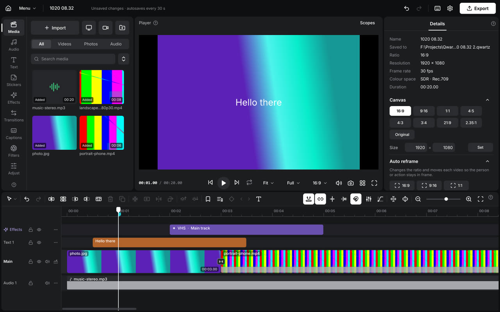

# Qwartz

**A fast, free video editor for Windows — made for creators.**

Free · No watermark · No account · Works offline

---

## ✨ Features

**Editing**
- Multi-track timeline with magnetic main track, snapping, ripple, roll, slip and slide
- Keyframes on everything, with a graph editor and custom curves
- Speed curves, smooth slow motion, freeze frames, reverse
- Compound clips, multicam, markers, render cache for heavy projects

**Look**
- 70+ effects, 70+ transitions and 80+ filters, with live previews
- Colour grading: curves, HSL, colour wheels, LUTs (.cube / .3dl), auto colour
- Masks, chroma key, blend modes, motion blur, stabilise, camera & motion tracking
- **AI background removal** — click the subject you want to keep

**Text & captions**
- **AI auto captions** with word-by-word timing and 20+ animated caption styles
- Text templates, animations (in / out / loop), gradients, outlines, 3D tilt
- 25 bundled fonts, colour emoji, 12 interface languages (incl. Arabic)

**Audio**
- Mixer, voice enhancement, noise reduction, voice changer
- Beat detection and cut-to-beat, auto ducking, loudness normalisation
- Split voice / music / sound effects

**Export**
- Up to 4K, 60 fps, HDR · H.264 / HEVC / ProRes / WebM / GIF
- Hardware encoding on NVIDIA, AMD and Intel
- Export queue, captions files, audio-only

**AI assistants (optional)**
- Let an AI assistant (e.g. Claude Desktop) edit inside Qwartz through MCP — off by default, enable it in *Settings → AI assistants*

---

## 📥 Download & install

1. Download the newest **`Qwartz-Setup-x.x.exe`** from **[Releases](https://github.com/elkalidjawed/qwartz-releases/releases/latest)**.
2. Run it. No admin rights needed — Qwartz installs just for your user.
3. Windows may show **"Windows protected your PC"** because the beta isn't code-signed yet: click **More info → Run anyway**.

Qwartz checks for new versions and offers to update itself.

### Requirements
| | Minimum | Recommended |
|---|---|---|
| System | Windows 10 (64-bit) | Windows 11 |
| Memory | 8 GB | 16 GB+ |
| Graphics | any (runs on the processor) | NVIDIA / AMD / Intel GPU with DirectX 12 |
| Disk | 2 GB | 4 GB+ (AI models download on first use) |

> Some AI features (auto captions, tracking) download their models the first time you use them (up to ~1.7 GB). After that they work offline.

---

## 🧪 This is a beta

Things may break — that's what the beta is for. Thank you for testing!

- **Something went wrong?** *Menu → Report a problem* saves a zip on your Desktop. Send it to the developer.
- **How do I…?** *Menu → Help* opens the full user guide (also works offline).

---

Built by some random dude named **elka** · Made with Claude Opus 5.5 *(usable and not slop)*

Qwartz is closed-source freeware. Third-party components and their licences are listed in the app under *Settings → About → Licences*.

